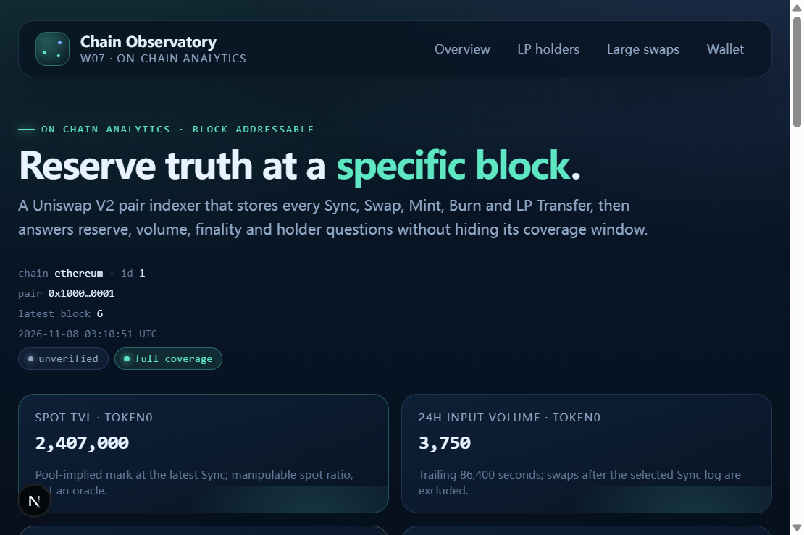

# W07 Chain Observatory

[Current self-assessment and release gates](docs/audit/review-2026-11-08.md) · [WSL source policy](docs/deployment/workspace-workflow.md)
**Block-addressable Uniswap V2 reserve, swap and LP analytics, with an explicit coverage and finality model.**

A TypeScript indexer built on Ponder that turns raw pair logs into reproducible reserve,
volume, fee and holder views. It stores raw integer amounts, anchors every snapshot to a
specific block hash and Sync log, exposes a guarded HTTP API, and ships a Next.js dashboard.

This is a portfolio project. The testnet data source is a clearly labeled `PairFixture`
contract, not a production AMM.



*Local demo with seeded fixture events: reserves, 24-hour volume, coverage and finality are
all explicit.*

## Business problem

A node can answer `eth_getLogs`, but an analytics product must answer harder questions:

- What were the reserves at this exact block, and which event defined them?
- Did the 24-hour volume include a swap that happened after the defining Sync?
- Is this observation final, orphaned, or simply unverified?
- Does the LP holder ranking cover the pair's full history, or only the indexed window?
- What happens when the chain reorganizes or the indexer is killed mid-stream?

W07 treats those as first-class outputs instead of hidden assumptions.

## Architecture

```text
Ethereum / Base Sepolia / Ethereum Sepolia RPC
        │  historical + live logs
        ▼
Ponder 0.18.4  ──►  pair_event / lp_balance (PGlite or PostgreSQL)
        │                 │
        │                 ├─ Sync / Swap / Mint / Burn / Transfer
        │                 └─ block hash + log index identity
        ▼
Hono HTTP API  ──►  Next.js 15 dashboard
  /metadata  /latest  /snapshot/:height  /series
  /wallet/:address  /alerts  /lp-holders
```

- **Indexer**: [ponder.config.ts](ponder.config.ts), [src/index.ts](src/index.ts)
- **Schema**: [ponder.schema.ts](ponder.schema.ts)
- **Financial semantics**: [src/math.ts](src/math.ts)
- **HTTP API**: [src/api/index.ts](src/api/index.ts)
- **Dashboard**: [apps/web](apps/web)
- **Test-only event source**: [testnet/fixtures](testnet/fixtures)
- **Design and limits**: [docs/design.md](docs/design.md)

## Tech stack

| Layer | Choice |
| --- | --- |
| Indexer | Ponder 0.18.4, viem 2.57.16 |
| API | Hono 4.13.16 |
| Storage | PGlite for local runs; PostgreSQL 16 for persistent serving |
| Dashboard | Next.js 15.5.29, React 19, server components, custom CSS/SVG |
| Tests | Node 24 test runner, Foundry, Anvil, PostgreSQL integration smoke |
| Tooling | TypeScript 5.9.3, Semgrep (where available), npm audit |

## Key features

- Five event handlers: `Swap`, `Sync`, `Mint`, `Burn`, `Transfer`.
- Primary key `block hash : log index`, so competing branches have distinct identities.
- Snapshot anchored to the **last Sync log at the requested height**.
- 24-hour input volume, spot TVL and gross fee APR in raw token units.
- Finalized-only reads against the configured RPC; `409` for live or orphaned blocks.
- `/latest` and `/series` endpoints for dashboards and charting.
- LP transfer history and projected positive holder balances with coverage metadata.
- Large token0 swap feed bounded to 7,200 blocks.
- Rate limit, request deadline, security headers, CORS allowlist and explicit `/metadata`.
- Next.js dashboard with reserve chart, snapshot, coverage panel, holders and alert feed.
- Reorg, crash-restart and PostgreSQL recovery tests against a real EVM.

## Metric semantics

All values are integer raw token units. No JavaScript floating point is used for accounting.

| Metric | Definition | Caveat |
| --- | --- | --- |
| `reserve0/1` | Last `Sync` at the requested block | Requires a Sync at that exact height |
| `spotTvlToken0` | `r0 + floor(r1 × r0 / r1)` | Pool-implied spot mark; manipulable |
| `volume24h` | Sum of `amount0In/amount1In` for swaps in the trailing 86,400s, bounded by the defining Sync log | Null until 24h of indexed history |
| `annualizedGrossFeeBps` | `floor(markedVolume × 30 × 365 / TVL)` | 30 bps assumption; not realized LP yield |
| LP balance | Transfer credits minus debits, zero address excluded | Only complete if indexing starts at pair creation |

## Security model and invariants

Trusted inputs: the configured RPC, the pair address, Ponder's log synchronization and the
database. The API does not sign transactions and holds no funds.

Executable invariants:

1. **Branch identity**: an event from an orphaned branch cannot share the primary key of a
   canonical event because the key includes the block hash.
2. **Rollback/replay**: replacing a block removes its reserve row, swap volume and LP deltas,
   then applies the replacement branch exactly once. Covered by `scripts/smoke-anvil.sh`.
3. **Post-Sync boundary**: a snapshot's 24h volume excludes Swap logs after the defining Sync
   log in the same block. Covered by the fixture and integration smoke test.
4. **Crash idempotence**: SIGKILL and restart on the same schema preserve the canonical
   snapshot and LP balances.
5. **Finality fail-closed**: missing RPC, invalid block shape, pending height or orphaned hash
   never returns `finalized`.
6. **Honest coverage**: `/metadata`, `/snapshot` and `/lp-holders` expose whether indexing
   started at or before pair creation; unverified snapshots are labeled.

## Testing strategy and results

Run from the repository root:

```sh
npm run check          # TypeScript
npm test               # 13 unit/integration tests
npm run coverage       # line/branch/function gates
npm run fixture:test   # Foundry tests for the test-only PairFixture
npm run smoke          # Anvil + Ponder end-to-end, PGlite
npm run smoke:postgres # PostgreSQL 16 + Anvil end-to-end
```

Observed on 2026-11-07:

| Suite | Result |
| --- | --- |
| TypeScript check | PASS |
| Node tests | PASS, 13/13 |
| Coverage | 97.19% lines, 86.96% branches, 100% functions on covered modules |
| Foundry fixture tests | PASS, 8/8 |
| Anvil smoke | PASS: Sync/Swap/LP replacement, post-Sync exclusion, 409 finality, SIGKILL restart |
| PostgreSQL smoke | PASS: same assertions with a real PostgreSQL 16 cluster |
| npm audit (production) | PASS, 0 advisories |
| Semgrep | BLOCKED: tool startup did not complete in the isolated WSL run; no scan result claimed |

The integration smoke test emits a Swap before Sync and another Swap after Sync in the same
transaction, then asserts that only the pre-Sync input enters the 24h window.

## Audit and remediation

- [Final assessment](docs/audit/final-report-2026-11-07.md)
- [Remediation review](docs/audit/remediation-review.md)
- [Dependency triage](docs/audit/dependency-triage.md)
- [Solidity bounded model](verification/solidity/README.md)

The final assessment is an **AI-assisted self-assessment**, not an independent third-party
audit. It lists open residual risks, including single-RPC finality trust and unproven
historical log completeness.

## Testnet deployment

The deployable artifact is a **test-only** `PairFixture` that emits Uniswap V2-shaped events.
It does not move tokens or hold value. See [docs/deployment/testnet.md](docs/deployment/testnet.md)
for the wallet, faucet, deployment, indexing and reconciliation procedure.

| Network | PairFixture | Block | Source |
| --- | --- | --- | --- |
| Base Sepolia | [`0x3d47…044F`](https://base-sepolia.blockscout.com/address/0x3d47126774E5B1E10d4Bf2093A52A1F0b2C6044F) | 55,659,119 | Sourcify `exact_match` |
| Ethereum Sepolia | [`0x4A9c…4999`](https://eth-sepolia.blockscout.com/address/0x4A9c4C103EC26ED88528A9c8DAf032BEdB854999) | 12,083,600 | Sourcify `exact_match` |

```sh
# Redeploy (keystore and funded wallet already exist):
W07_CHAIN=base-sepolia npm run deploy:testnet
W07_CHAIN=ethereum-sepolia npm run deploy:testnet
# Point the indexer at the recorded address and block:
W07_CHAIN=base-sepolia \
RPC_URL=https://base-sepolia.gateway.tenderly.co \
PAIR_ADDRESS=<recorded> \
START_BLOCK=<block> \
PAIR_CREATION_BLOCK=<block> \
npm start
```

Ponder resolves its finalized boundary with a historical block probe, so the Base Sepolia RPC
must serve old blocks. `sepolia.base.org` prunes before block 46,500,000; the Tenderly public
gateway is used instead.

Deployment records are written to [deployments](deployments) only after real receipts exist.
No placeholder addresses or transactions are committed. The end-to-end record is in
[testnet-verification-2026-11-07.md](docs/deployment/testnet-verification-2026-11-07.md).

## Live API

A read-only indexer is running on a Tencent Cloud server. Two isolated instances index the
Base Sepolia and Ethereum Sepolia `PairFixture` deployments:

```text
Dashboard: https://w07-chain-observatory.vercel.app
API:       https://onchaindata.purelamp.uk/metadata          # Base Sepolia, chain id 84532
           https://onchaindata.purelamp.uk/latest
           https://onchaindata.purelamp.uk/series?from=55659119&to=<latest>
           https://onchaindata.purelamp.uk/eth/metadata      # Ethereum Sepolia, chain id 11155111
           https://onchaindata.purelamp.uk/eth/latest
```

Each instance has its own database, so the two chain windows cannot overwrite each other's sync
state. Coverage is complete for both fixtures (`START_BLOCK` equals each creation block). The
24-hour volume and fee APR stay `null` until a fixture window spans 24 hours.
`w07-api.purelamp.uk` is also configured in Caddy and becomes active once its DNS record is
added. See [docs/deployment/server-live.md](docs/deployment/server-live.md) and
[docs/deployment/vercel-live.md](docs/deployment/vercel-live.md).

## Quick start

```sh
# Dependencies
npm ci
npm --prefix apps/web ci

# Native local demo: Anvil + fixture events + Ponder API on :42069
npm run dev:demo

# In another terminal: dashboard on :3000
INDEXER_URL=http://127.0.0.1:42069 npm run web:dev

# Stop the demo processes
npm run stop:demo
```

To index a real pair, copy `.env.example` to `.env`, set `W07_CHAIN`, `RPC_URL`,
`PAIR_ADDRESS` and `START_BLOCK`, then run `npm run dev`.

## Design trade-offs

- **Last Sync, not interpolation**: snapshots require a Sync at the exact height. This is
  conservative and reproducible; it refuses to invent reserves between observations.
- **Raw units**: formatting is a presentation concern. Integer accounting stays exact.
- **One pair per schema**: simpler invariants and safe multi-chain operation via separate
  schemas/instances. A shared multi-pair schema would need a wider key and query changes.
- **PGlite by default**: zero external setup for review. PostgreSQL is the persistent serving
  path and is exercised in CI-style smoke tests.
- **Dashboard server-side fetch**: the indexer URL never enters browser JavaScript; no CORS
  is needed for the default deployment.
- **Test fixture instead of a production AMM**: deterministic public-testnet evidence without
  pretending the fixture is a real market.

## Known limitations

- Historical log completeness is not independently proven. A finalized block hash proves the
  block, not that every log in the configured range was fetched.
- Finality trusts one configured RPC. No quorum or fallback is implemented.
- LP rankings require indexing from pair creation. `PAIR_CREATION_BLOCK` is only asserted
  when configured and verified; otherwise coverage is labeled partial.
- Volume uses block timestamps, including the lower 24h endpoint; exact second-level windows
  are not possible from logs alone.
- The alert feed does not dispatch notifications and is not finality-filtered.
- The preview API is single-process; the rate limiter is in-memory and not shared.
- The testnet fixture is synthetic and has no economic meaning.

## Future improvements

- Multi-RPC finalized quorum and automatic fallback.
- Pair-creation discovery and a backfill verifier.
- PostgreSQL `EXPLAIN ANALYZE` load evidence for the alert and series queries.
- Shared rate limiting and request budgets for multi-instance deployment.
- Alert delivery with dedupe and cooldown.
- A ClickHouse path only if measured analytical query cost justifies it.

## Engineering contributions

- Product scope, schema, event handlers, API, dashboard, tests and documentation were built
  for this portfolio project with AI assistance.
- Ponder owns log synchronization, checkpointing and rollback; viem owns RPC encoding; Hono
  owns HTTP routing; Next.js owns rendering. Those frameworks are not reimplemented here.
- The Solidity `ValuationModel` and `PairFixture` are small, purpose-built artifacts; their
  tool outputs are evidence for those exact artifacts, not for the TypeScript indexer.

## Hosted UI evidence

[Protected Vercel deployment](https://w07-chain-observatory-6n0r4iad7-purelamp.vercel.app). Authenticated Chromium desktop and 390px mobile rendering passed with no page errors or horizontal overflow. [Evidence](evidence/hosted-ui-20261109/acceptance.json). This check does not establish hosted wallet transaction acceptance. Access protection remains enabled.

[Engineering, self-review and public testnet evidence](docs/deployment/acceptance-2026-11-09.md)
