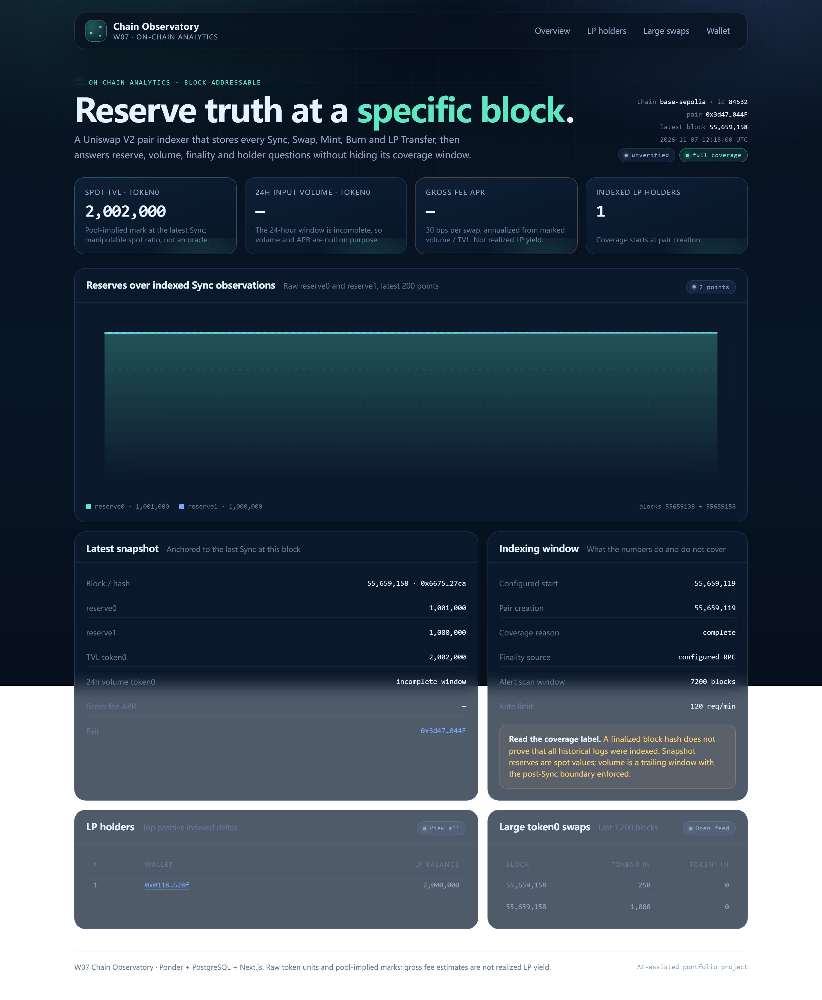

# Vercel dashboard deployment — 2026-11-07

Status: **LIVE**.

| Item | Value |
| --- | --- |
| Production URL | `https://w07-chain-observatory.vercel.app` |
| Source | Private repo `chenhynju/w07-chain-observatory` |
| Root Directory | `apps/web` |
| Framework | Next.js 15 (detected) |
| API source | `https://onchaindata.purelamp.uk` (code default, overridable by `INDEXER_URL`) |
| Trigger | GitHub integration: push to `main` deploys automatically |

## Verification

`GET https://w07-chain-observatory.vercel.app` returned HTTP 200. The rendered HTML
contained the hero `Reserve truth at a specific block.` and the metric cards `Spot TVL`,
`24h input`, `Gross fee APR` and `Indexed LP holders`. It did not contain the
`Indexer is offline` state, so the server-side fetch reached the cloud indexer.

After commit `4fbbbf7` the dashboard reads the Base Sepolia fixture: the HTML contains chain id
`84532` and pair `0x3d47126774E5B1E10d4Bf2093A52A1F0b2C6044F`, and no longer contains the
Ethereum mainnet pair. The screenshot above was captured after this switch.

## Pending

- Custom domain `w07.purelamp.uk`: add it in the Vercel project and point Cloudflare DNS at
  Vercel. The apex `purelamp.uk` already resolves to Vercel; the API subdomain is separate.
- `w07-api.purelamp.uk` has a Caddy site block but no DNS record; `onchaindata.purelamp.uk` is
  the active branded API host.
- The Vercel project is private-repo backed; reviewers need repository access or a public
  deployment URL.
